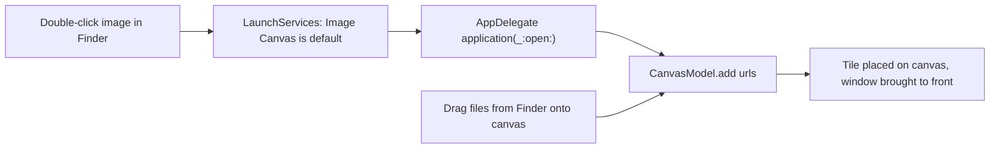

# Image Canvas Mac app

Build a native SwiftUI/AppKit macOS app called Image Canvas. It registers as the opener for common image types, and every image you double-click joins one canvas window as a tile. You can drag tiles freely, or drop them on an edge or corner to snap them to a half or quadrant, the way Windows Snap works.

# Image Canvas: a Mac image viewer with snapping

## Context
- The project folder is empty and not yet a git repo.
- The toolchain is macOS 26.6, Xcode 27.1 and Swift 6.4 (arm64).
- Your choices: **one canvas window** where images are tiles, and **all common image types** (JPEG, PNG, HEIC, GIF, WebP, TIFF, BMP).
- I'll build with **Swift Package Manager plus a small bundling script** rather than a hand-written `.xcodeproj`. The script assembles a real `.app` with a custom `Info.plist`, which is what Finder needs to offer the app as an opener. `Package.swift` still opens in Xcode if you want to edit there.

## How opening a file reaches the canvas

- The app uses a single-instance SwiftUI `Window` scene, not `WindowGroup`, so opening more files never spawns new windows. Each file just becomes another tile.
- `NSApplicationDelegateAdaptor` receives `application(_:open:)`. This covers both a cold launch and a running app.

## Canvas behaviour
- **Tiles**: each tile shows its image aspect-fit on a dark background. Clicking a tile brings it to front. Hovering shows the filename and an X button to close it. Delete removes the selected tile.
- **Free drag**: drag a tile anywhere. A corner handle resizes it.
- **Snap zones** are based on where the pointer is while dragging, as in Windows:
  - Within about 24pt of the left, right, top or bottom edge, the tile snaps to that **half**.
  - Within about 24pt of an edge and also within about 80pt of a corner, it snaps to that **quadrant**.
  - A translucent preview rectangle shows the target zone while you drag. Dropping commits the snap.
- **Un-snap**: dragging a snapped tile away restores its pre-snap size, as Windows does.
- **Double-click a tile** to toggle it filling the whole canvas.
- **Layout scales with the window**: frames are stored normalized (0 to 1) relative to the canvas, so snapped and free tiles reflow when the window is resized or goes full screen. Snapping is to the canvas, so making the window full screen means snapping to the screen.
- **New tiles**: a new image opens centered and cascaded at about 50% of the canvas. The menu command **Arrange > Tile All** (Cmd-G) lays all tiles out in a grid.
- **Memory**: images load through `CGImageSource` thumbnails with a max dimension of about 3000px, so huge photos stay light. HEIC, WebP and GIF decode natively.
- Closing the window quits the app and clears the canvas. Nothing is saved between sessions.

## Becoming the default viewer
- `Info.plist` declares `CFBundleDocumentTypes` / `LSItemContentTypes`:
  - `public.jpeg`
  - `public.png`
  - `public.heic`
  - `com.compuserve.gif`
  - `org.webmproject.webp`
  - `public.tiff`
  - `com.microsoft.bmp`
- The app menu gets a **Make Default Image Viewer** item, which calls `NSWorkspace.shared.setDefaultApplication(at:toOpen:)` for each type. macOS shows its own confirmation, which is unavoidable.
- On first launch, the app offers this once.
- Manual fallback, documented in the README: Finder > Get Info > Open with > Change All.

## Files
- [Package.swift](Package.swift): executable target `ImageCanvas`, macOS 14 or later.
- [Sources/ImageCanvas/ImageCanvasApp.swift](Sources/ImageCanvas/ImageCanvasApp.swift): `@main`, the `Window` scene, menu commands and the `AppDelegate`.
- [Sources/ImageCanvas/CanvasModel.swift](Sources/ImageCanvas/CanvasModel.swift): an `@Observable` model holding tiles, z-order, selection, add, remove, snap and tile-all.
- [Sources/ImageCanvas/Tile.swift](Sources/ImageCanvas/Tile.swift): the tile struct (id, url, image, normalized frame, snap zone, pre-snap size) and the image loader.
- [Sources/ImageCanvas/SnapZone.swift](Sources/ImageCanvas/SnapZone.swift): an enum covering four halves and four quadrants, with `zone(for:in:)` and `rect(in:)`. These are pure functions and unit-testable.
- [Sources/ImageCanvas/CanvasView.swift](Sources/ImageCanvas/CanvasView.swift): the tile ZStack, snap preview overlay and Finder drop target.
- [Sources/ImageCanvas/TileView.swift](Sources/ImageCanvas/TileView.swift): the image, drag and resize gestures, hover chrome and double-click to fill.
- [Sources/ImageCanvas/DefaultHandler.swift](Sources/ImageCanvas/DefaultHandler.swift): sets the default-app registration.
- [Resources/Info.plist](Resources/Info.plist): bundle id `com.dan.ImageCanvas` and the document types.
- [Tests/ImageCanvasTests/SnapZoneTests.swift](Tests/ImageCanvasTests/SnapZoneTests.swift): tests for zone detection and rects.
- [scripts/build-app.sh](scripts/build-app.sh): runs `swift build -c release`, assembles `build/Image Canvas.app`, ad-hoc codesigns it, copies it to `~/Applications` and re-registers it with `lsregister -f`.
- [README.md](README.md): build, install, set-default and usage notes.

## Verification
1. Run `swift test`; the snap-zone tests should pass.
2. Run `scripts/build-app.sh`, then `open -a "Image Canvas"` on a few sample JPEG, PNG and HEIC files. All of them should land in one window.
3. Check by hand: drag to each edge and corner and confirm the preview and snap; un-snap; resize the window and full screen and confirm reflow; drop files from Finder.
4. Run Make Default, then double-click a JPEG in Finder. It should open in Image Canvas and add to the existing canvas.

## Out of scope for now
- Per-tile zoom and pan
- Saving layouts
- Windows-style "snap assist" suggestions
- Notarization (it's ad-hoc signed for local use)

## Todos

- [ ] git init, create Package.swift, Resources/Info.plist with document types, .gitignore
- [ ] Implement Tile, image loader (CGImageSource downsampling), SnapZone and CanvasModel
- [ ] Implement CanvasView and TileView: drag, snap preview, unsnap, resize handle, double-click fill, close/delete, Finder drop
- [ ] Implement ImageCanvasApp with single Window scene, AppDelegate application(_:open:), menu commands (Tile All, Make Default)
- [ ] Implement DefaultHandler using NSWorkspace.setDefaultApplication plus first-launch prompt
- [ ] Add SnapZone unit tests and run swift test
- [ ] Write scripts/build-app.sh (build, assemble .app, codesign, install to ~/Applications, lsregister) and README; build and smoke-test opening multiple images
