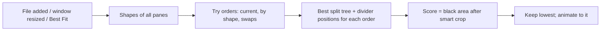

# Best-fit tiling with smart crop

Replace the equal-size "even out" with a layout that looks at each image's and video's shape and picks the arrangement and pane sizes that leave the least black space. Each picture may also be trimmed by up to about 10% at its edges when that closes a gap.

# Best-fit tiling with smart crop

## Why there's black space today
- `Layout.balanced` in [Sources/CanvasCore/Layout.swift](Sources/CanvasCore/Layout.swift) gives every pane the same area and ignores what shape the picture is. A tall phone photo in a wide pane therefore leaves big black bars on both sides.
- Pictures are always shrunk to fit inside their pane. The only alternative is the all-or-nothing **Crop to Fill Panes** toggle.

## The fix, in three parts

### 1. Know each picture's shape
In [Sources/ImageCanvas/Tile.swift](Sources/ImageCanvas/Tile.swift) and [Sources/ImageCanvas/CanvasModel.swift](Sources/ImageCanvas/CanvasModel.swift), each pane remembers its width-to-height shape once it loads:
- **Images:** taken from the already-rotated decoded image.
- **Videos:** taken from the video track's size, with its rotation applied, so phone videos come out tall.
- **Not yet loaded:** treated as neutral.
- **Re-arranging:** when a shape arrives after its pane was placed, the layout re-arranges once.

### 2. Smart crop (new in [Sources/CanvasCore/Fit.swift](Sources/CanvasCore/Fit.swift))
- One shared rule decides how big a picture is drawn in a pane:
  - Start from "fit inside".
  - Allow enlarging until up to `maxCrop` of the picture's width or height is trimmed off. The default is 10%, split between the two edges.
  - Never enlarge beyond "fill the pane".
- The same rule gives each pane's **coverage** (how much of the pane the picture fills). Drawing and layout scoring therefore always agree.
- [Sources/ImageCanvas/TileView.swift](Sources/ImageCanvas/TileView.swift) draws images and videos at that size, centred and clipped. Videos get a sized player layer, since the built-in video modes are only "fit" or "fill". Pinch zoom still works on top.
- **Settings > Layout** gets a slider "Allow trimming edges up to: 0-25%", default 10%. The existing **Crop to Fill Panes** stays as the 100% option.

### 3. Best-fit layout search (new in [Sources/CanvasCore/BestFit.swift](Sources/CanvasCore/BestFit.swift))
- **Goal:** minimise total black area, which is each pane's area times the share of it the picture doesn't cover.
- **Splitting for a given order:** a search over every way of splitting the list into left/right or top/bottom groups. Each group's natural shape is the combined shape of what's inside it: side by side, the widths add up; stacked, the heights add up. Each divider is placed where both sides match their contents' shape, then nudged a few candidate positions and the best kept. Results are remembered, so up to about 16 panes stays quick.
- **Trying other orders:** the original order, orders sorted by shape, and swapping pairs of panes while it keeps improving. There's a time budget of about 30ms, after which the best layout found so far is used.
- **Ties:** when two layouts are about equal, the current order wins, so things don't shuffle for no gain.
- **Never worse:** the result is never worse than an equal-size even split. That's a built-in check, and a test.

## When it runs
- **Adding files:** best fit replaces the current "even out on every add".
- **Arrange > Best Fit (Cmd-G):** runs it on demand. **Arrange > Even Out** stays, with a new shortcut, Shift-Cmd-G.
- **Window resize or full screen:** re-runs about 0.3 seconds after the size stops changing, but only while the layout is still automatic. Once you drag a pane, snap one, or move a divider, your arrangement is left alone until the next add or Cmd-G.

## Tests
- **Unit tests** (new [Tests/CanvasCoreTests/BestFitTests.swift](Tests/CanvasCoreTests/BestFitTests.swift)):
  - The coverage and crop maths.
  - Two tall images on a wide canvas end up side by side with almost no black.
  - One wide image plus two tall ones produces the expected arrangement.
  - Results are never worse than even-out, and the same input always gives the same layout.
  - 16 panes finish within the time budget.
  - Panes still cover the whole canvas with no gaps or overlaps, using the existing check.
- **In-app self-test:**
  - Open a mix of tall, wide and square test images and record the black-area share for even-out versus best fit. The check expects a clear drop.
  - A window-only screenshot of before and after.
  - Confirm that a manual drag stops automatic re-fitting on resize.

## Not in scope
- Free-form overlapping panes. The canvas stays edge-to-edge stained glass. "Overlap" here means the picture's trimmed edges extend under the pane border, not panes on top of each other.
- Picking a different crop position per image, such as by detecting faces. The crop is always centred.

## Todos

- [ ] Record each tile's aspect ratio on load (image dims; video track size with rotation) and re-run layout when an aspect arrives
- [ ] Add CanvasCore/Fit.swift: smart-crop display size and pane coverage from aspect, pane, maxCrop
- [ ] Render images and videos at the smart-crop size (sized AVPlayerLayer for video), centred and clipped, composing with pinch zoom
- [ ] Add CanvasCore/BestFit.swift: memoised split-tree search per order, divider refinement, order search with time budget, never-worse-than-balanced guard
- [ ] Use best fit on add, Arrange > Best Fit (Cmd-G), keep Even Out (Shift-Cmd-G), auto re-fit on window resize while layout is auto
- [ ] Settings > Layout: 'Allow trimming edges up to' slider (0-25%, default 10%), persisted
- [ ] Unit tests for Fit and BestFit (coverage, arrangements, determinism, performance, gapless)
- [ ] Self-test: measure black area even-out vs best fit on mixed-aspect images, window-only screenshot, manual-edit stops auto re-fit
- [ ] Update README, rebuild and install, commit and push to GitHub and Bridge
